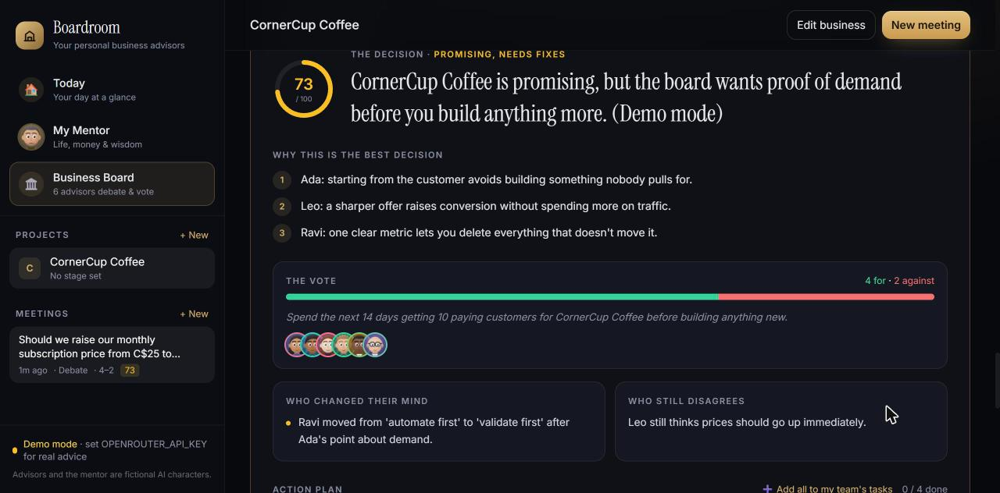
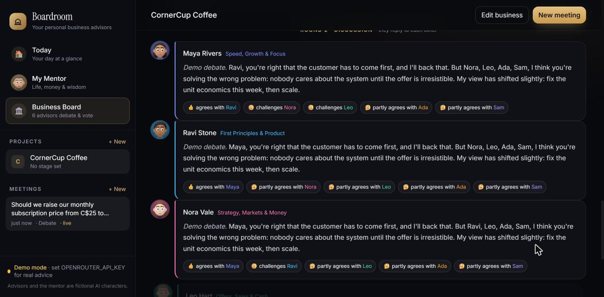
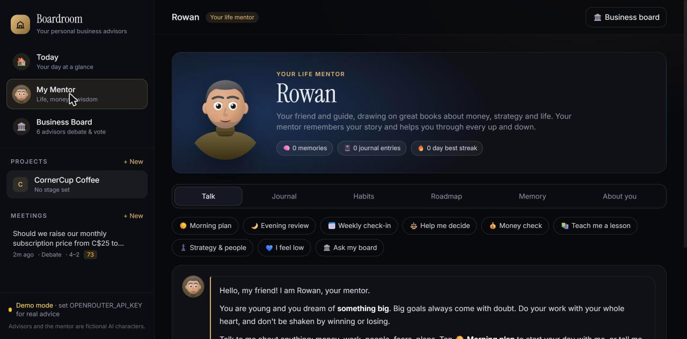

# Boardroom

A full-stack AI web app that gives a founder a private board of advisors. Six fictional AI advisors review your business, debate each other, vote on a motion, and turn it into one decision with an action plan. A separate AI mentor helps with daily planning, habits and money.

**Tech:** Python, FastAPI, Pydantic, JavaScript, Tailwind CSS, LLM API integration (OpenRouter)



## How a board meeting works

1. **Describe your business** once, and optionally attach documents.
2. **Ask a question**, and choose which advisors join.
3. **Each advisor answers** from their own area: growth, product, strategy, sales, operations or finance.
4. **They debate**, replying to each other's points and showing who agrees or disagrees.
5. **They vote** on a motion, and can change their minds.
6. **You get one final decision** with a score, the reasons, any disagreement, and an action plan you can add to your task list.



## Features

**Business board**
- Full debate and quick-answer meetings
- Idea lab that proposes and ranks new business and growth ideas
- Team task list, with tasks owned by each advisor
- Weekly board reports
- Optional web search for real facts and sources
- PDF, Word, Excel, CSV and text upload, used as context for the advice

**Life mentor**
- Morning plans, evening reviews and weekly check-ins
- Journal, habit tracker and net worth tracker
- Year-by-year roadmap toward a big goal
- Long-term memory of what you tell it, which you can view and edit



## Technical highlights

- **FastAPI back end** with Pydantic models validating every request
- **Multi-step AI workflow:** each advisor's answer feeds into the debate, then the vote, then the final decision
- **Structured output:** the AI returns JSON, which the app parses into scores, votes and action plans
- **Document parsing** with size limits and clear error messages for unsupported or scanned files
- **Demo mode:** runs with no API key and no cost, using sample answers
- **Local data:** projects are stored in the browser and mentor data in a local JSON file, which Git ignores

## Run it yourself

You need Python 3.10 or newer.

```bash
pip install -r requirements.txt
python app.py
```

Then open http://127.0.0.1:8000. With no API key, the app runs in demo mode.

**To get real AI answers:** copy `.env.example` to `.env`, add your [OpenRouter](https://openrouter.ai/keys) key, and restart the app. API usage costs money.

## Project structure

```text
app.py            FastAPI app, advisors, board meeting and idea lab routes
mentor.py         Life mentor routes and data storage
index.html        Main page and shared front-end code
static/           Front-end code for each section
screenshots/      Pictures used in this README
```

## Notes

- All advisors and the mentor are fictional AI characters. Their advice is not professional financial, legal or medical advice.
- Screenshots show demo mode and a made-up sample business.
- Developed with the help of AI coding tools.

## Author

Harshil Vaishnav | [LinkedIn](https://www.linkedin.com/in/harshil-vaishnav-5502bb3ab)
